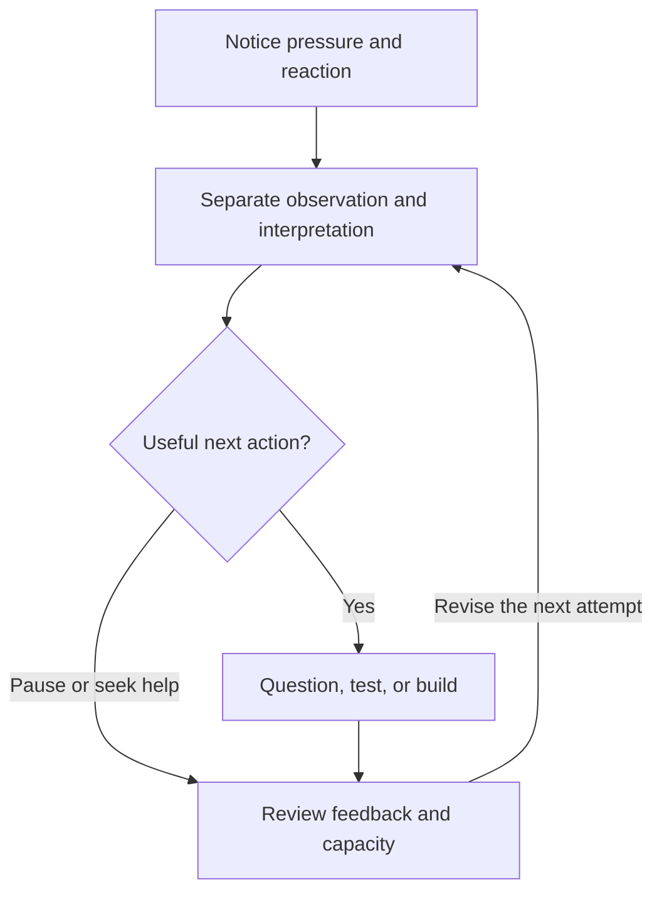

# From Pressure to Useful Work: A Curiosity and Feedback Loop

Date: 2026-11-12
Status: Proposed methodology and field-manual exercise v0.1; not an evaluated intervention.
Origin: Anthony P.'s November 12 spoken reflections; structured into a proposed workflow by ChatGPT. This public adaptation excludes personal medical history, private transcripts, and identifying third-party details.

## Purpose
Practice responding to comparison, criticism, or misunderstanding with a deliberate next action. The aim is useful learning and cooperation. Increased posting, stronger emotion, or more attention alone do not establish improvement.

## The loop

Pausing, leaving an exchange, and asking for assistance are legitimate outcomes. The loop does not require seeking out conflict or returning to a harmful situation.

## Field-manual card
1. Notice: name the reaction and what actually happened.
2. Separate: write one observation, one interpretation, and what remains unknown.
3. Choose: clarify, build a small artifact, ask for help, pause, or disengage.
4. Act: take one bounded step that serves the current goal.
5. Review: what changed, what did it cost, and should the next attempt change?

A possible third move is introducing a clarifying question, a shared task, a neutral facilitator, or a useful tool. This may create room for cooperation; it does not guarantee another person's agreement.

## Worked example
Observation: a feed contains posts advertising rental businesses.
Interpretation: the viewer feels behind and pressured to change direction.
Question: which parts of this business model actually help the planned offering?
Action: extract one equipment-maintenance question for a portable kit checklist, then return to the current task.
Review: was the checklist improved, was the task completed, and was the time spent worthwhile?

This is an illustrative exercise, not a measured result or a claim about anyone's motives.

## Humor and reassessment
The founder describes humor as sometimes producing both self-judgment and renewed motivation. Record those stages separately rather than forcing a helpful/harmful binary. Ask: what did the joke bring up, what happened next, and did it help return to a useful action? Harsh self-judgment is not a required training step.

## Low-stakes teaching exercise
Use a fictional misunderstood instruction or a frustrating cooperative game puzzle. Model the card once, invite an attempt, then ask the learner to explain their next decision. Do not manufacture bullying, use humiliation, or require personal disclosures. Participants may stop. Support and boundaries belong in the exercise.

## Tracking template
One row per attempt; leave unknowns blank, never record them as zero.

| Field | Record |
|---|---|
| Attempt and date | Unique ID and timestamp |
| Observation | What occurred, without assigning motives |
| Interpretation and uncertainty | Initial explanation and alternatives |
| Reaction | Optional self-description in the participant's own terms |
| Objective | What useful outcome matters now |
| Chosen action | Clarify, test, build, pause, leave, or ask for help |
| Minutes spent | Actual elapsed time when recorded |
| Artifact or task | Link/version and done, blocked, or skipped |
| Feedback | Source, exact issue, and whether it is independent |
| Revision | What changed because of feedback |
| Capacity check | Continue, simplify, rest, or request support |
| Next test | Small action and review point |

## Graph plan
No outcome dataset has been collected for this note. Do not draw an improvement curve from this conversation.

After collecting comparable attempts:
- Plot elapsed minutes per attempt as points over attempt order. Retain unfinished attempts with their status; quicker is not automatically better.
- Plot counts of completed useful actions and feedback-led revisions per defined period; show total attempts alongside them.
- If voluntary pressure ratings are used, show within-person before/after pairs on a consistently defined scale. These are subjective self-reports, not clinical scores.
- Annotate changes in task difficulty, available time, support, and workload.
- Review several attempts before suggesting a trend. A graph can describe observations; it cannot by itself establish causation.

## Transfer to enterprise
An artifact may improve a checklist, instruction, prototype, or service design before producing income. Track usefulness, costs, and income separately.
For Kit 001, preserve the sequence: define the portable astronomy kit; secure funding and the shopping list; assemble and test; then approach existing venues. Gaming integration and other future modules remain distinct from claims of a ready offer.

## Publication and evaluation
The working hypothesis is that explicitly separating observation, interpretation, and action may support clearer decisions. Evaluation should include unclear explanations, unhelpful artifacts, extra workload, and occasions when pausing was the best outcome.
This is a proposed general learning method. It is not a clinical treatment, suicide-prevention protocol, or proof that stressful gaming environments build resilience.

Related existing candidate directions: ITI-RP-040, 081, 084, 085, 086, 087, 088, 099, 116. This note develops existing directions; no new candidate ID is assigned.
Related notes: [Operational Discernment](2026-11-11-operational-discernment.md) and [Core Loop Tuning](2026-11-11-core-loop-tuning.md).

Original public text in this note is designated under the repository's [license notice](../LICENSE-NOTICE.md).
